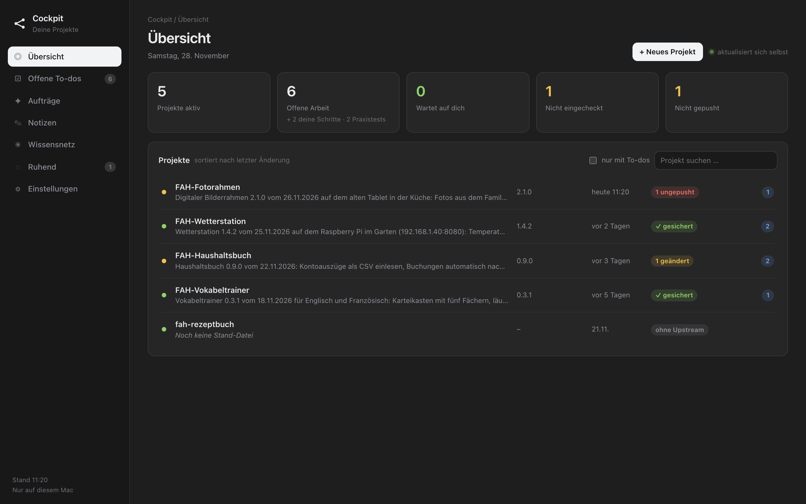
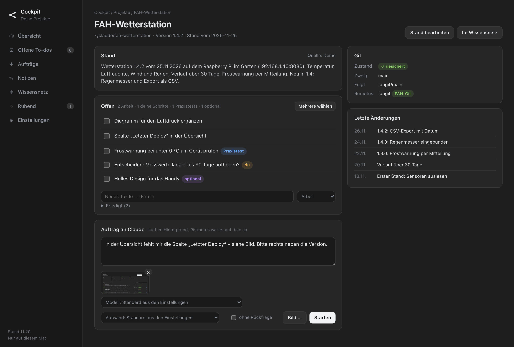
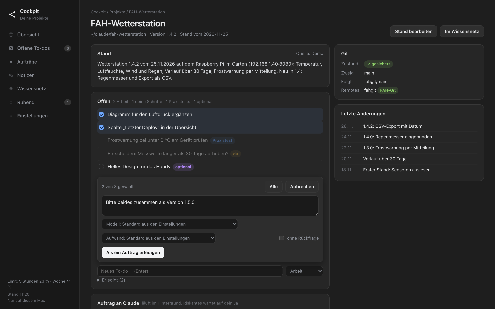
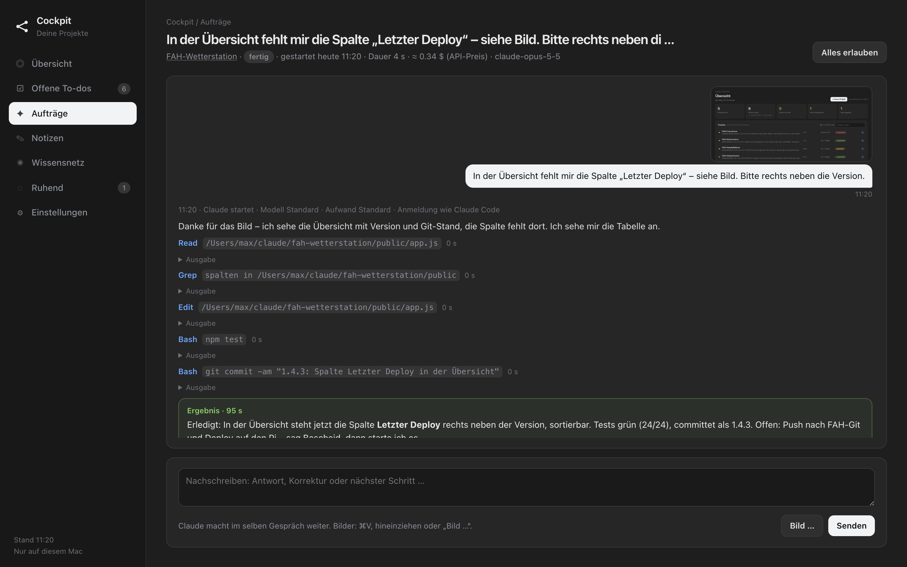
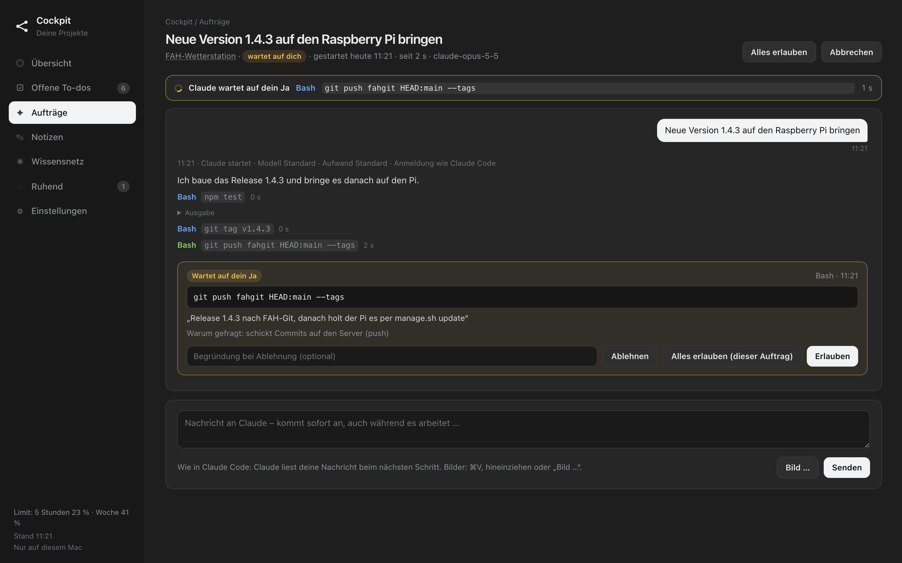
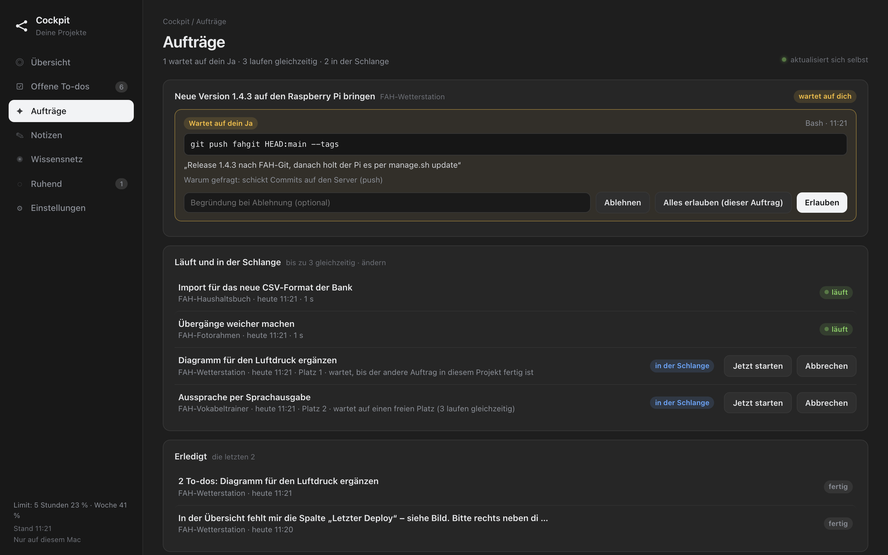
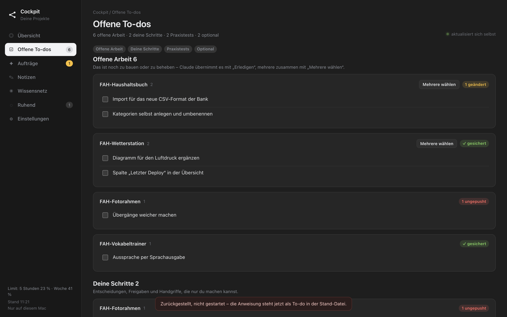
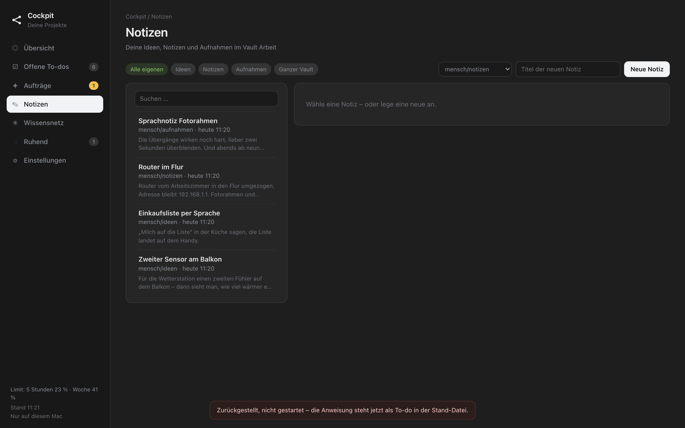
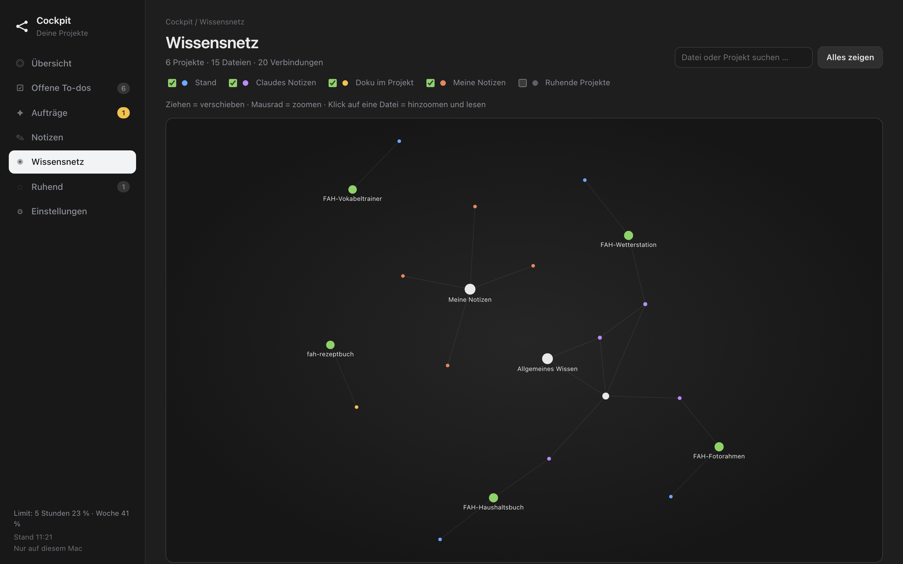
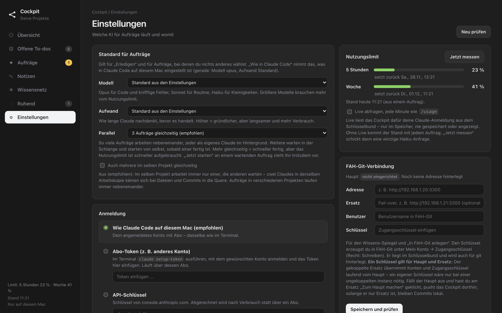

# FAH-Cockpit – deine Projekte und Claude in einer Mac-App

Alle Projekte auf einen Blick: Stand, offene To-dos, Git-Zustand. Ein Klick auf „Erledigen“, und Claude arbeitet das
To-do im Hintergrund ab – auch mehrere Aufträge gleichzeitig. Was nach außen geht (push, ssh, Deploy, Uploads, Löschen),
wartet als Karte auf dein Ja. Alles läuft lokal auf deinem Mac.

## ⬇️ Download

**[FAH-Cockpit herunterladen (ZIP, ca. 45 MB)](https://github.com/Arachnolord/fah-cockpit/releases/latest/download/fah-cockpit_release.zip)**

Alle Versionen: [Releases](https://github.com/Arachnolord/fah-cockpit/releases) · für Macs mit Apple-Chip (M1 und neuer), ab macOS 14

## So sieht es aus

**Übersicht** – alle Projekte mit Stand, Version, letzter Änderung, Git-Zustand und offener Arbeit:

**Projektseite** – Stand, To-dos nach Art, Git und letzte Commits; unten der Auftrag an Claude, hier mit eingefügtem Bild:

**Mehrere To-dos in einem Auftrag** – „Mehrere wählen“, To-dos antippen, dann „Als ein Auftrag erledigen“: Claude
arbeitet sie der Reihe nach in einem Gespräch ab und pusht am Ende einmal gesammelt:

**Auftrag** – Claude arbeitet im Hintergrund, jeder Schritt mit Dauer und Ausgabe:

**Freigabe** – Schritte nach außen warten auf dein Ja:

| Aufträge – mehrere gleichzeitig, der Rest in der Schlange (vorziehen oder abbrechen) | Offene To-dos über alle Projekte |
|---|---|
|  |  |
| **Notizen** | **Wissensnetz** |
|  |  |

**Einstellungen** – Modell, Aufwand, wie viele Aufträge parallel laufen, Anmeldung und Nutzungslimit:

## Erster Start

1. ZIP entpacken und **FAH-Cockpit.app** in „Programme“ ziehen.
2. Starten. Die App ist nicht von Apple notarisiert: Meldet macOS, dass sie sich nicht öffnen lässt, unter
   Systemeinstellungen → Datenschutz & Sicherheit ganz unten „Trotzdem öffnen“ wählen.
3. Der **Einrichtungs-Assistent** führt durch den Rest: Claude Code installieren und anmelden, git, Projektordner,
   Vault, Mitteilungen und „Beim Anmelden starten“.

## So benutzt du es

- **Projekte** sind Ordner unter `~/claude` (je ein Git-Repo). „+ Neues Projekt“ legt Ordner, Git und Stand-Datei an –
  auf Wunsch baut Claude es gleich nach deiner Beschreibung.
- **Stand und To-dos** stehen je Projekt in einer Markdown-Datei im Vault (`~/claude/Arbeit/maschine/projekte/<Ordner>.md`)
  mit den Abschnitten `## Stand`, `## Offen` (`- [ ] …`) und `## Erledigt`. Claude pflegt sie nach jedem Auftrag, du
  kannst sie im Cockpit selbst bearbeiten. Ein Kennzeichen vorn am To-do sortiert es: `(Betreiber)` für deine eigenen
  Schritte, `(Praxistest)` für Prüfungen am echten Gerät, `(optional)`.
- **Aufträge:** „Erledigen“ an einem To-do, „Mehrere wählen“ für mehrere To-dos in einem Auftrag oder eine eigene
  Anweisung auf der Projektseite. Ein wartender Auftrag lässt sich mit „Abbrechen“ aus der Schlange nehmen: Seine To-dos
  bleiben offen, eine eigene Anweisung kommt als To-do in die Stand-Datei. Bilder kommen mit ⌘V,
  durch Hineinziehen (auch aus der Vorschau oder aus Fotos) oder über „Bild …“ dazu. Während Claude arbeitet, kannst du
  nachschreiben. Bis zu fünf Aufträge laufen gleichzeitig (Standard drei), im selben Projekt immer einer nach dem anderen.
- **Menüleiste:** Das Symbol zeigt, wenn ein Auftrag auf dich wartet, und das Nutzungslimit; dazu gibt es echte
  Mitteilungen.
- **Notizen und Wissensnetz:** Ideen und Notizen im Vault lesen und bearbeiten; das Wissensnetz zeigt Projekte, Notizen
  und Doku als Graph.
- **Sichern (optional):** Stand und Claudes Notizen je Projekt in einen Ordner (iCloud, NAS) oder auf einen eigenen
  Git-Server wie [FAH-Git](https://github.com/Arachnolord/fah-git).

## Voraussetzungen

- Mac mit Apple-Chip, macOS 14 oder neuer
- [Claude Code](https://claude.com/claude-code) mit Claude-Abo – oder ein API-Schlüssel
- git (Xcode-Befehlszeilenwerkzeuge)

## Gut zu wissen

- Das Cockpit lauscht nur auf diesem Mac (127.0.0.1:8130); nach außen spricht nur Claude Code mit deinem Konto.
- Jeder Auftrag ist ein eigenes Claude im Hintergrund. Mehrere gleichzeitig sind schneller fertig, verbrauchen das
  Nutzungslimit aber auch schneller.
- Protokoll: `~/Library/Logs/fah-cockpit.log`.

## Fremdbestandteile

- [Node.js](https://nodejs.org) (offizielles Paket, MIT-Lizenz) liegt der App bei: `Contents/Resources/node/LICENSE`.

(c) 2026 Fabian Hammer – Alle Rechte vorbehalten.
