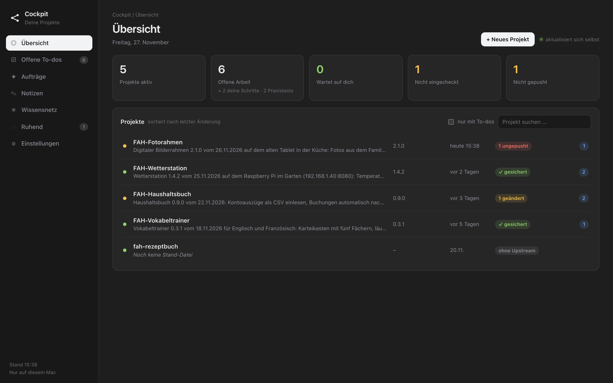
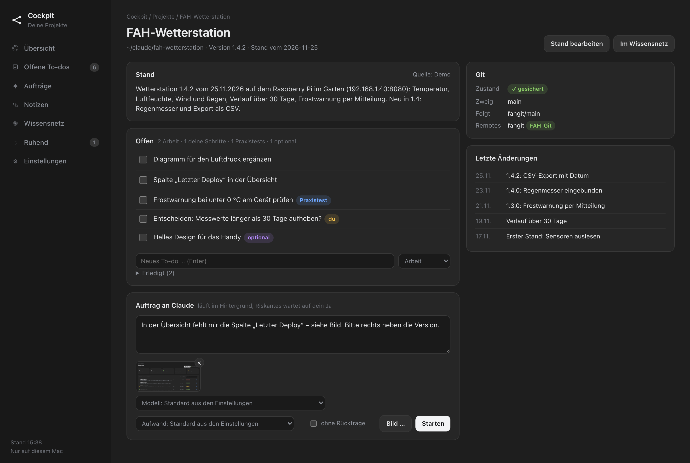
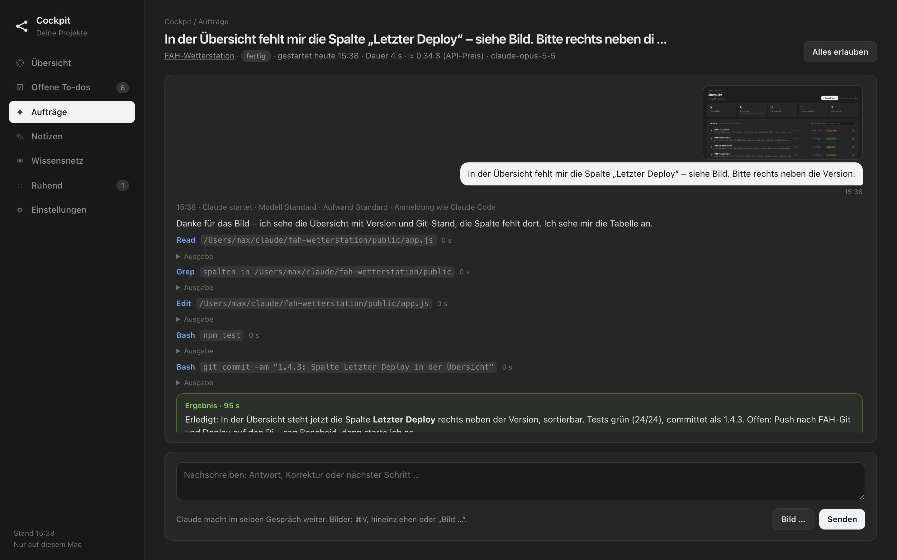
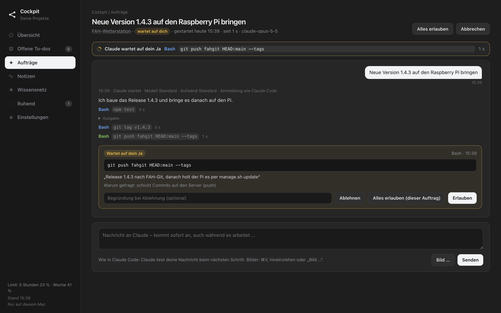
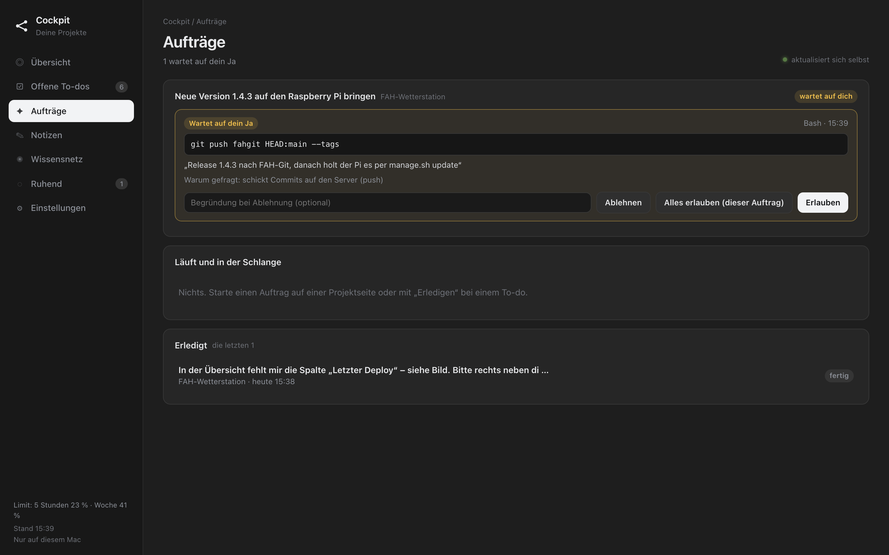
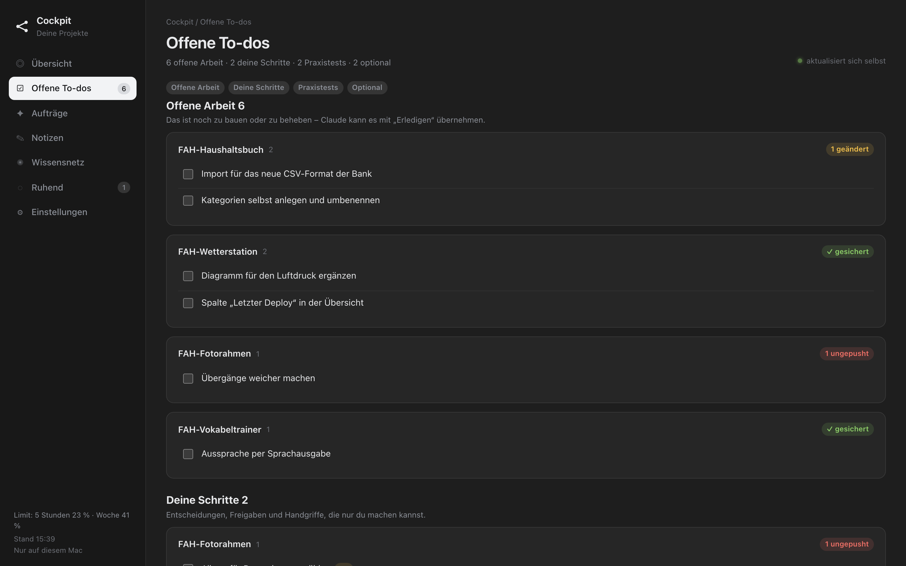
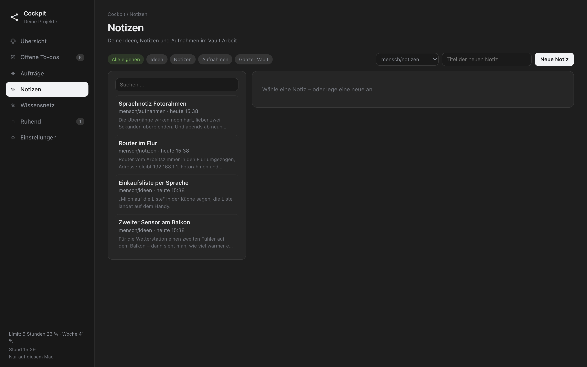
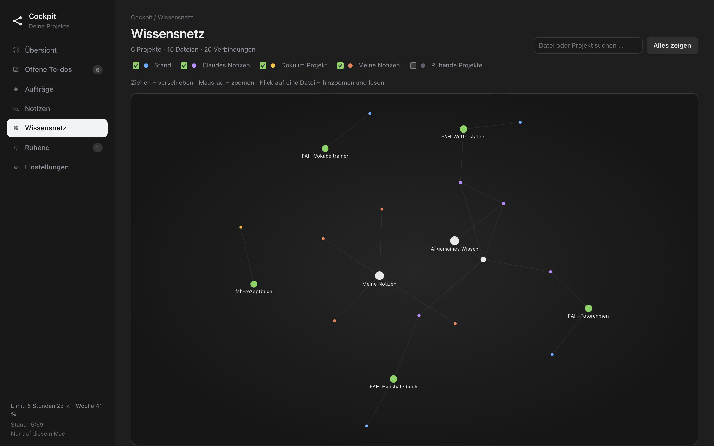
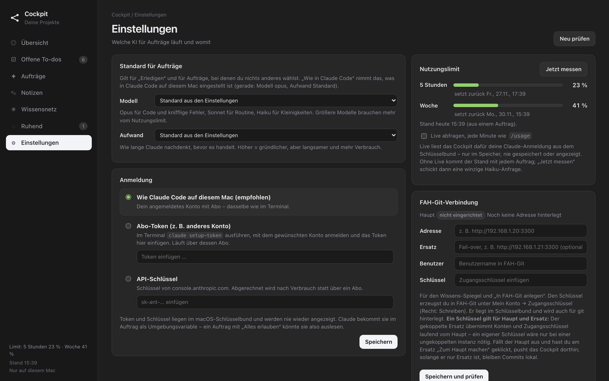

# FAH-Cockpit

Stand und offene To-dos aller Projekte unter `~/claude` auf einen Blick – lokal auf dem Mac unter
**http://localhost:8130**.

- **Übersicht:** alle Projekte mit Version, letzter Änderung, Git-Zustand (nicht eingecheckt / nicht gepusht) und Zahl offener To-dos.
- **Offene To-dos:** alle To-dos über alle Projekte, direkt abhakbar.
- **Projektseite:** Stand in Sätzen, To-dos, Git-Fakten, letzte Commits, „Stand bearbeiten“.
- **Aufträge an Claude:** „Erledigen“ an jedem To-do oder eine Anweisung je Projekt. Claude arbeitet im Hintergrund;
  Claude Code entscheidet wie im Terminal; nur Schritte nach außen (push, ssh, Deploy, Uploads, Löschen …) warten als Karte
  auf dein Ja – „Alles erlauben (dieser Auftrag)“ wie im Multitool.
- **Bilder in die Chatzeile (seit 0.14.0):** wie im Terminal mit ⌘V einfügen (Bildschirmfoto, kopiertes Bild, im Finder
  kopierte Bilddatei), hineinziehen oder „Bild …“ – beim Auftrag, beim Nachschreiben und bei „Von Claude bauen lassen“.
  Claude bekommt das Bild selbst zu sehen; im Verlauf steht es in deiner Blase (Klick = groß).
- **Notizen und Bearbeiten:** Ideen, Notizen, Aufnahmen und jede Datei im Vault lesen und bearbeiten (⌘S), neue Notiz,
  Papierkorb, „Stand bearbeiten“ und „Neues To-do“ – kein Obsidian nötig.
- **Wissen sichern:** Stand und Claudes Notizen je Projekt nach FAH-Git – oder ohne FAH-Git in einen Ordner
  (z. B. `~/claude`, iCloud, NAS); nach der Ordnerwahl startet der Abgleich sofort.
- **FAH-Git-Ersatz (Fail-over):** Fällt der Haupt aus und hat der Ersatz übernommen, pusht das Cockpit dorthin;
  sonst bleibt alles lokal, bis der Haupt wieder da ist.
- **Neues Projekt:** „+ Neues Projekt“ legt Ordner, Git, Stand-Datei und FAH-Git-Projekt an – auf Wunsch baut Claude
  es gleich nach deiner Beschreibung (Live-Ansicht, mitschreiben, freigeben).
- **Wissensnetz:** wie die Graph-Ansicht in Obsidian – Projekte als Knotenpunkte mit Stand, Notizen und Doku; Klick zoomt hin
  und zeigt die Datei.
- **Wissen in FAH-Git:** alle 30 Minuten Stand und Claudes Notizen je Projekt nach `claude-wissen/`, das ganze Gedächtnis
  nach `~/claude/claude-gedaechtnis` – nie zu GitHub, frederix nie.
- **Einstellungen:** welche KI läuft, Standard-Modell und -Aufwand, Anmeldung (Claude Code, Abo-Token oder API-Schlüssel).

Stand und To-dos kommen aus dem Vault `~/claude/Arbeit/maschine/projekte/<Ordner>.md`, den Git-Teil misst das
Cockpit bei jedem Aufruf selbst (nur lokal, kein `git fetch`).
Die Seite aktualisiert sich selbst: alle 30 s, solange der Tab sichtbar ist (verdeckt: Pause, beim Zurückkommen sofort);
neu gezeichnet wird nur bei Änderungen und nie, während du tippst. Der Server startet per LaunchAgent mit der Anmeldung. Aufbau und Gründe: [docs/design.md](docs/design.md).

## So sieht es aus

Aufgenommen aus einer Probe-Instanz mit erfundenen Daten (`node werkzeuge/bildschirmfotos.mjs` – macht die Bilder nach
jeder sichtbaren Änderung neu und bedient dabei die Oberfläche).

**Übersicht** – alle Projekte mit Stand, Version, letzter Änderung, Git-Zustand und offener Arbeit:



**Projektseite** – Stand, To-dos nach Art, Git, letzte Commits; unten der Auftrag an Claude mit eingefügtem Bild (⌘V):



**Auftrag** – Claude arbeitet im Hintergrund, jeder Schritt mit Dauer und Ausgabe; das Bild steht in deiner Nachricht:



**Freigabe** – Schritte nach außen (push, ssh, Deploy …) warten auf dein Ja:



| Aufträge | Offene To-dos |
|---|---|
|  |  |
| **Notizen** | **Wissensnetz** |
|  |  |

**Einstellungen** – welche KI läuft, Modell und Aufwand, Anmeldung, Nutzungslimit, FAH-Git-Verbindung:



## Installation auf einem Mac (seit 0.7.0)

**FAH-Cockpit.app** enthält alles: offizielles Node 26 LTS, den Cockpit-Code, eigenes Fenster, Menüleisten-Symbol mit
„wartet auf dich“ und Nutzungslimit, echte Mitteilungen. ZIP: `NEUE ZIPs/Eigene Apps/Mac-Apps/fah-cockpit_release.zip`
→ nach /Applications ziehen → starten. Der **Einrichtungs-Assistent** (Menü FAH-Cockpit → Einrichtung …, ⌘,) prüft
Claude Code (installieren/anmelden), git, Projektordner, Vault, Dienst, Mitteilungen und „Beim Anmelden starten“.
Bauen: `mac/bauen.sh` (lädt Node einmal von nodejs.org und prüft die SHA-256, signiert mit dem Apple-Development-Zertifikat).

## Betrieb ohne App (alt)

```
./werkzeuge/installieren.sh     # LaunchAgent de.fah.cockpit einrichten bzw. neu starten
npm test                        # Tests (node --test)
node werkzeuge/bildschirmfotos.mjs   # Bedienprobe + Bilder für „So sieht es aus“ (--nur-probe: ohne Bilder)
tail ~/Library/Logs/fah-cockpit.log
```

Umgebungsvariablen (optional): `COCKPIT_PORT` (8130), `COCKPIT_WURZEL` (~/claude), `COCKPIT_VAULT` (~/claude/Arbeit).
Lauscht nur auf 127.0.0.1. Node ≥ 22, keine Fremdpakete.

(c) 2026 Fabian Hammer – Alle Rechte vorbehalten.
